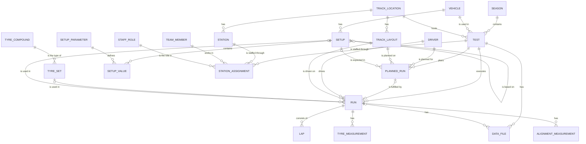

# Test Data Manager: database design

## 1. Entity-relationship diagram



## 2. Units and conventions

- All quantities are metric/SI. The unit is written at the end of the column name:
  `_m` metres, `_s` seconds, `_c` degrees Celsius, `_kpa` kilopascals, `_kg` kilograms,
  `_deg` degrees, `_mm` millimetres, `_pct` percent, `_bytes` bytes.
- Setup parameters store their unit as text in `setup_parameter.unit` (for example
  `N/mm`, `kW`, `clicks`), so the unit of every setup value is documented in the data itself.
- Corners are `FL` (front-left), `FR` (front-right), `RL` (rear-left), `RR` (rear-right).
  Whole-vehicle setup values use the code `VEH`.
- Toe: positive means toe-in. Camber: negative means the top of the wheel tilts towards the car.
- Lap time: `lap_time_s` is the raw time and `penalty_s` is stored separately.
  The effective time is `lap_time_s + penalty_s`.
- Dates are stored as text in ISO format: `YYYY-MM-DD`, and `YYYY-MM-DD HH:MM:SS` for date and time.
- Yes/no values are stored as `0` and `1`.
- SQLite only enforces foreign keys when `PRAGMA foreign_keys = ON;` is run on each connection.
  `create_db.py` does this.

## 3. Main design decisions

The reasoning behind the main decisions is in `docs/Thoughtprocess.md`.

## 4. Derived data (views)

Anything that can be calculated is not stored, so it cannot go out of date.

- `run_distance`: laps x track length, per run. Totals for a test, season, driver or vehicle
  (which gives the lifetime total) are a `SUM(distance_m)` with a `GROUP BY`.
- `setup_change`: for each run, the setup values that changed compared with the previous run
  of the same test, with the old value, the new value, the date and the reason.
- `planned_vs_actual`: compares each planned run with what happened and labels it
  `as planned`, `modified`, `cancelled`, `not executed` or `added` (a run with no plan).
- The best lap of a run is a query, not a column:

```sql
SELECT run_id, MIN(lap_time_s + penalty_s) AS best_lap_s
FROM lap
GROUP BY run_id;
```

## 5. Backend, frontend and importer

- **Backend** (`backend/app.py`, FastAPI). `GET /runs` accepts any combination of filters
  (season, driver, compound, tyre set, asphalt and ambient temperature range, dates...).
  `GET /mileage?group_by=run|test|season|driver|vehicle` returns kilometres. There are also
  endpoints for tests, plan vs actual, lookup lists and a few `POST` endpoints for adding data.
  All SQL uses `?` placeholders, and a rule broken in the database returns a clean 409 error.
  Interactive documentation is at `/docs`.
- **Frontend** (`frontend/index.html`): one page to search runs, see the mileage and compare
  plan with actual for a test day. It only reads data.
- **Importer** (`tools/import_legacy.py`): loads messy CSV files. The strategy is in
  `docs/IMPORT.md`.
- **Tests** (`tests/`): mileage, best lap, historical queries, setup changes, plan vs actual,
  database constraints and triggers, and the importer.

## 6. How to run it

Python 3.10 or newer is needed (it includes SQLite).

```
bash tdm.sh setup     # virtual environment, libraries, and the database with seed data
bash tdm.sh run       # start the app: http://127.0.0.1:8000
bash tdm.sh test      # run the automated tests
```

Without the script: `python3 create_db.py`, then `uvicorn backend.app:app --reload`.
`create_db.py` deletes the old `tdm.db` and rebuilds it from `db/schema.sql` and `db/seed.sql`.

## 7. Status and known limitations

Built: database, backend, frontend, CSV importer, automated tests, setup script.
Docker: a Dockerfile and a compose file (docker compose up --build), tested on macOS with Docker Desktop.

Not done or simplified:

- No migration tool (for example Alembic). The database is rebuilt from `schema.sql`, which is fine
  for a demo but not for a database that already holds real data.
- The frontend only reads data. Adding data works through the API (`/docs`), but there are no forms.
- No login. Anyone who can reach the server can read and change data.
- Library versions in `requirements.txt` are not pinned.

Known weak points of the design:

- The triggers only run on `INSERT`, not on `UPDATE`.
- `setup_change` compares a run only with the previous run of the same test, so the first run of
  a day is not compared with the last run of the previous test.
- `planned_vs_actual` calls a run `modified` if the driver, layout, setup or lap count differ.
  It does not compare timing or the battery limit.
- A cancelled plan can still have an actual run linked to it. The database does not forbid it.
- `run.completed_laps` is typed in and can differ from the number of `lap` rows. Mileage uses the
  `lap` rows.
- All setup values are plain numbers, so the database cannot give each parameter its own range
  or type.
- Drivers and team members are two tables, although a driver is also a team member. One `person`
  table would be cleaner.
- Tyre sets are not tied to a vehicle or a season.
- SQLite allows little writing at the same time. It is used for simplicity, and the schema is
  standard enough to move to PostgreSQL.